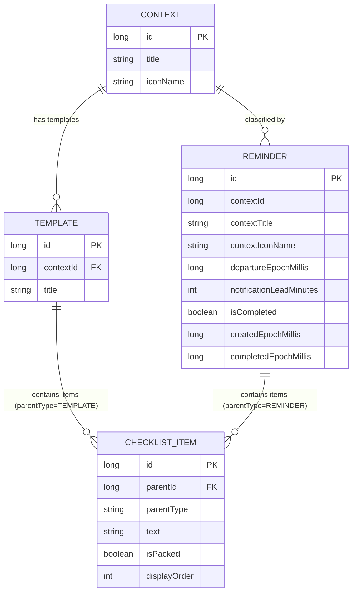

# 🔔 Dont Forget - Contextual Checklist & Reminder App

[](https://kotlinlang.org)
[](https://developer.android.com)
[](https://developer.android.com/jetpack/compose)
[](#architecture--design-patterns)
[](#-ai-assisted-chunk-driven-development-cdd)
[](LICENSE)

**Dont Forget** is a native Android application built with Kotlin and Jetpack Compose that helps users organize departure checklists and contextual reminders so they never forget essential items when traveling, going to work, hitting the gym, or embarking on trips.

---

## 📱 Features

- **Context-Aware Reminders**: Create departure reminders tailored to specific contexts (*Work, Gym, Trip, Flight, Commute*).
- **Interactive Packing Checklists**: Checklist items tied to each reminder with instant toggle capabilities, progress tracking, and single-tap "Pack All" functionality.
- **Smart Departure Warning & Notification Lead Times**: Configurable notification lead times (e.g., 15m, 30m, 1h, 2h before departure) with real-time warnings for invalid or near-past departure times.
- **Reusable Templates**: Create, edit, and organize checklist templates for recurring trips or routines.
- **Reliable System Alarms**: Uses Android's `AlarmManager` for precise scheduling (`setExactAndAllowWhileIdle`), delivering high-priority notifications even when the app is closed.
- **Boot & Update Resilience**: `BootReceiver` automatically reschedules pending alarms whenever the device reboots or the package is updated.
- **Auto-Cleanup**: Automated background deletion of completed/expired inactive reminders older than 24 hours.
- **Modern UI & Dark Mode**: Full Material 3 dynamic styling, edge-to-edge layout, and adaptive light/dark mode support.

---

## 🔮 Upcoming Features & Roadmap (v2.0)

The upcoming **v2.0 release** brings major feature expansions, user experience refinements, and system enhancements:

### ✨ New Features
- **Centralized Notification Center**: A dedicated screen to view upcoming scheduled notifications and review past notification history.
- **Recurring & Custom Repeat Schedules**: Flexible repeating options for reminders (e.g., Weekdays `Mon–Fri`, `Mon–Sat`, `Mon–Sun`, or custom selected days).
- **Multi-Day Calendar View**: Integrated calendar picker allowing users to schedule and manage reminders spanning across multiple days.
- **Interactive First-Time Onboarding**: Guided demo screens introducing new users to core features and workflows.
- **Multi-Language & Localization**: Full internationalization support including Tamil, Hindi, Spanish, French, and additional languages.

### 🎨 User Interface & Experience
- **Drag-and-Drop Checklist Reordering**: Fluid drag-and-drop gestures for reordering checklist items, replacing button controls.
- **Refreshed Brand Identity**: Redesigned application icon and modernized visual logo.
- **Overdue Card Visual Contrast**: Improved color contrast on "OVERDUE" status cards for higher readability across light and dark themes.

### ⚡ Fixes & Functional Refinements
- **Seamless Creation Navigation**: Automatic redirection back to the Home screen immediately upon saving a new reminder.
- **Chronological Upcoming Reminders**: Display upcoming reminders strictly in ascending order by scheduled departure time.
- **Precise Overdue Evaluation**: Refined overdue calculation using exact timestamp comparisons (hours and minutes) rather than date boundaries alone.

### ♿ Accessibility & Responsiveness
- **Adaptive Screen Layouts**: Responsive UI design optimized across Compact (phones), Medium (foldables), and Expanded (tablets/desktops) window size classes.
- **Comprehensive Accessibility Enhancements**: Expanded TalkBack screen reader support, optimized touch target sizes, and enriched accessibility semantics across all screens.

---

## 🏗 Architecture & Design Patterns

The project strictly follows **Clean Architecture** principles paired with the **MVI (Model-View-Intent)** presentation pattern for unidirectional data flow (UDF) and predictable state management.

```
┌─────────────────────────────────────────────────────────────┐
│                      Jetpack Compose UI                     │
└──────────────┬──────────────────────────────▲───────────────┘
               │ Emits UiEvents               │ Observes UiState / SideEffects
               ▼                              │
┌─────────────────────────────────────────────┴───────────────┐
│              BaseViewModel <UiState, UiEvent, UiSideEffect> │
└──────────────┬──────────────────────────────▲───────────────┘
               │ Invokes operations           │ Emits Flow updates
               ▼                              │
┌─────────────────────────────────────────────┴───────────────┐
│                   Repository Layer                          │
└──────────────┬──────────────────────────────▲───────────────┘
               │ Room DAO calls               │ Flow Data Streams
               ▼                              │
┌─────────────────────────────────────────────┴───────────────┐
│                    Room Local Database                      │
└─────────────────────────────────────────────────────────────┘
```

### 1. Model-View-Intent (MVI) Pattern
All ViewModels inherit from `BaseViewModel<S : UiState, E : UiEvent, SE : UiSideEffect>`:
- **`UiState`**: Immutable representation of the screen's UI state, exposed via `StateFlow`.
- **`UiEvent`**: User intents or actions dispatched to the ViewModel (`onEvent(event)`).
- **`UiSideEffect`**: One-time single-shot events (navigation, toast/snackbar feedback) driven by a buffered Kotlin `Channel`.

### 2. Layer Structure
- **`core/mvi/`**: Abstract `BaseViewModel` contract and generic state/event/effect interfaces.
- **`core/navigation/`**: Type-safe navigation routes (`Route`) and bottom navigation configuration (`BottomNavItem`).
- **`core/ui/`**: Reusable Material 3 composables (`AppTopBar`, `AppBottomBar`, `WarningBanner`, `ConfirmationDialog`, `ContextIcons`).
- **`data/local/`**: Room database (`DontForgetDatabase`), entities, DAOs, and relational data wrappers (`ReminderWithItems`, `TemplateWithContextAndItems`).
- **`data/repository/`**: Abstraction repositories (`ReminderRepository`, `TemplateRepository`) handling business logic and system interactions.
- **`feature/`**: Modularized features containing MVI contracts, ViewModels, and Jetpack Compose screens:
  - `home/`: Active & completed reminders tabs, fast actions.
  - `createreminder/`: Wizard for context selection, template loading, departure time picker, lead time selection.
  - `editreminder/`: Edit context, departure time, and checklist items.
  - `reminderdetail/`: Interactive checklist detailed view.
  - `templates/`: Template management (list, detail view, editing).
- **`notification/`**: System alarm scheduling (`ReminderAlarmScheduler`), notification channels & builder (`ReminderNotificationManager`), and broadcast receivers (`ReminderBroadcastReceiver`, `BootReceiver`).

---

## 🤖 AI-Assisted Chunk-Driven Development (`chunks/`)

This codebase is architected using **Chunk-Driven Development (CDD)**—a structured strategy specifically designed for AI-assisted engineering workflows (e.g. Gemini, Claude, Cursor, Copilot, Android Studio AI Assistant).

### What is `@chunks`?
A **chunk** is an isolated, self-contained feature specification directory located in [`chunks/`](file:/DontForget/chunks). Instead of passing a massive monolithic specification into an AI prompt, the app is decomposed into discrete, bite-sized engineering milestones:

- `chunk-00-foundation`: Core Gradle dependencies, Material 3 design system, Room DB, MVI base framework, repositories, and navigation.
- `chunk-01-home-and-reminders`: Home screen, active/completed reminder lists, fast-pack capability, and auto-purge logic.
- `chunk-02-create-edit-reminder`: Create/Edit reminder wizard, context pickers, departure date/time scheduling, and lead time selectors.
- `chunk-03-template-management`: Reusable template CRUD, item management, and context associations.
- `chunk-04-notifications-scheduling`: `AlarmManager` integration, exact alarms, and receiver scheduling.
- `chunk-05-notification`: System notification channels, high-priority notifications, and deep link entry.
- `chunk-06-bottom-navigation`: Scaffolding, bottom navigation bar, and top bar configurations.

### Standardized Chunk Anatomy
Each `chunks/chunk-XX-*/` directory contains standardized specification files:

| Specification File | Purpose & Contents |
| :--- | :--- |
| `00-brief.md` | Name, scope, architectural pointers, UI references, contract points, and **strict ownership boundaries** ("May touch" vs "May NOT touch"). |
| `01-contract.md` | Public API definitions, exported contracts, and repository/model interfaces. |
| `02-ui.md` | Jetpack Compose layout requirements, UI hierarchy, and UX interaction rules. |
| `03-behaviour.md` | Business rules, user journeys, edge cases, and state handling. |
| `04-ui-state.md` | Data structures for `UiState`. |
| `05-events.md` | Sealed classes/interfaces for user `UiEvent`s. |
| `06-viewmodel.md` | ViewModel state reducer & effect handling specifications. |
| `07-side-effects.md` | Single-shot `UiSideEffect` definitions. |
| `08-navigation.md` | Navigation routes, arguments, and handoffs. |
| `09-tests.md` | Test scenarios, unit test assertions, and coverage goals. |
| `11-review.md` | Post-chunk completion checklist and verification rules. |

### Why Use Chunk-Driven Development for AI Workflows?
1. **Context Window Efficiency**: AI models perform best when provided with targeted context. Prompting an AI tool with a specific chunk brief (e.g. `@chunks/chunk-01-home-and-reminders/00-brief.md`) supplies exact requirements without cluttering the LLM context window with unrelated code.
2. **Strict Ownership Boundaries**: Each `00-brief.md` explicitly lists **"May touch"** and **"May NOT touch"** paths. This prevents AI coding assistants from unintentionally modifying core files or causing regressions in adjacent modules.
3. **Contract-First Safety**: Defining public interfaces in `01-contract.md` ensures dependent components can be built in parallel without breaking changes.
4. **Deterministic & Testable Code**: Every chunk mandates unit test specs (`09-tests.md`) and self-review steps (`11-review.md`), guaranteeing high code quality before moving to the next chunk.

### How a Developer or AI Agent Uses `chunks/`
- **Prompting AI Assistants**: Reference the chunk spec directly in your AI prompt:
  > *"Read `@chunks/chunk-02-create-edit-reminder/00-brief.md` and implement the departure warning banner according to `@chunks/chunk-02-create-edit-reminder/03-behaviour.md`."*
- **Adding New Features**: To add a new feature, create `chunks/chunk-07-your-feature/` following the same 11-step blueprint. This ensures any AI assistant can implement the feature predictably.
- **Agent Skills Integration**: The project includes AI Agent skills in `.agents/skills/` (such as `android-chunk-workflow`, `android-feature-contract`, `android-ui-state`, `android-events`, `android-tdd`, `android-self-review`) which automatically guide AI assistants to adhere to the project's chunk rules and MVI patterns.

### 🤝 Developer Contributions & Chunk Maintenance

To maintain seamless AI-assisted development across the project's lifecycle, **all contributors (human and AI) must keep the `chunks/` specifications up-to-date as living documentation**.

#### Contribution Checklist for Developers:
1. **Update Chunks When Modifying Features**:
   - If you modify business logic, UI state, user events, or navigation for an existing feature, **update the corresponding files in `chunks/chunk-XX-feature-name/`** (e.g. `01-contract.md`, `03-behaviour.md`, `04-ui-state.md`, `09-tests.md`).
   - *Why this matters*: AI assistants rely on `chunks/` as their primary source of ground truth. Outdated chunk specs will cause future AI prompts to generate obsolete code, break existing contracts, or undo intent.
2. **Creating New Chunks for New Features**:
   - When introducing a new feature, initialize a new chunk folder: `chunks/chunk-07-your-feature-name/`.
   - Populate the standard specification files (`00-brief.md` through `11-review.md`). Define public interfaces and explicit file ownership boundaries (`May touch` vs `May NOT touch`) before writing implementation code.
3. **Contract-First Updates**:
   - If a change impacts shared data entities, DAO signatures, or repositories, update `01-contract.md` in `chunk-00-foundation` first, then verify that consumer chunks reflect the change.
4. **Synchronize Unit Tests**:
   - Always update `09-tests.md` whenever new edge cases, ViewModel events, or repository behaviors are introduced, and ensure all tests pass (`./gradlew :app:testDebugUnitTest`).

---

## 📊 Database Schema & Data Models



---

## 🛠 Tech Stack & Dependencies

- **Language**: [Kotlin 2.2.10](https://kotlinlang.org/)
- **Build System**: Gradle 8.x / 9.x with Version Catalogs (`gradle/libs.versions.toml`)
- **Android Gradle Plugin (AGP)**: 9.3.3
- **SDK Target**: Target SDK 37, Min SDK 24
- **UI Framework**: Jetpack Compose with Material 3 Design
- **Navigation**: Jetpack Navigation Compose (`2.8.8`)
- **Database**: Room Persistence Library (`2.8.4`) with KSP code generation
- **Asynchronous / Reactive**: Kotlin Coroutines & Flow (`kotlinx.coroutines`)
- **Testing**: JUnit 4, Kotlinx Coroutines Test, Espresso, Compose UI Test

---

## 📁 Project Directory Structure

```
DontForget/
├── .agents/                              # AI Agent Skill Definitions
│   └── skills/                           # Custom agent skills for Chunk Workflow & MVI
├── app/
│   ├── build.gradle.kts
│   └── src/
│       ├── androidTest/                  # Instrumentation & UI Tests
│       ├── main/
│       │   ├── AndroidManifest.xml
│       │   └── java/com/example/dontforget/
│       │       ├── MainActivity.kt
│       │       ├── core/
│       │       │   ├── mvi/             # MVI Contracts & BaseViewModel
│       │       │   ├── navigation/      # Routes & BottomNavItem
│       │       │   └── ui/              # Reusable Composables
│       │       ├── data/
│       │       │   ├── local/           # Room DB, DAOs, Entities & Models
│       │       │   └── repository/      # Repository layer & implementations
│       │       ├── feature/             # MVI Feature Modules
│       │       │   ├── createreminder/
│       │       │   ├── editreminder/
│       │       │   ├── home/
│       │       │   ├── reminderdetail/
│       │       │   └── templates/
│       │       ├── notification/        # AlarmManager & BroadcastReceivers
│       │       └── ui/theme/            # Material 3 Color, Spacing, Theme
│       └── test/                        # Comprehensive Unit Test Suite
├── chunks/                               # Chunk-Driven Development Specifications
│   ├── chunk-00-foundation/
│   ├── chunk-01-home-and-reminders/
│   ├── chunk-02-create-edit-reminder/
│   ├── chunk-03-template-management/
│   ├── chunk-04-notifications-scheduling/
│   ├── chunk-05-notification/
│   └── chunk-06-bottom-navigation/
├── gradle/
│   └── libs.versions.toml                # Centralized Gradle Dependency Catalogs
├── UI References/                        # UX / UI Design Mockups & Screenshots
├── build.gradle.kts                      # Root Gradle Configuration
└── settings.gradle.kts                   # Project Settings & Subproject Inclusion
```

---

## 🚀 Getting Started

### Prerequisites
- **JDK 17** or **JDK 21** installed.
- **Android Studio** (Ladybug / Meerkat or newer recommended).
- Android SDK with API Level 37 installed.

### Build & Run
1. **Clone the repository**:
   ```bash
   git clone https://github.com/your-repo/dont-forget.git
   cd dont-forget
   ```
2. **Open in Android Studio**:
   Select `File > Open` and choose the project directory.
3. **Build via Gradle CLI**:
   ```bash
   ./gradlew assembleDebug
   ```
4. **Deploy to Device / Emulator**:
   Run the `app` target from Android Studio or via ADB:
   ```bash
   ./gradlew installDebug
   ```

---

## 🧪 Testing Strategy

The application includes unit tests for ViewModels, Repositories, MVI State Flow transitions, and Side-effects.

To execute the unit test suite:
```bash
./gradlew :app:testDebugUnitTest
```

### Test Coverage Highlights:
- **`BaseViewModelTest`**: Validates initial state delivery, state reducers, and buffered effect streaming.
- **`ReminderRepositoryTest`**: Verifies CRUD operations, item packing, and alarm cancellation/scheduling.
- **`TemplateRepositoryTest`**: Verifies template and context persistence.
- **ViewModel Unit Tests**: Covers `HomeViewModelTest`, `CreateReminderViewModelTest`, `EditReminderViewModelTest`, `ReminderDetailViewModelTest`, `TemplateManagementViewModelTest`, `TemplateDetailViewModelTest`, and `TemplateEditViewModelTest`.

---

## 🔐 Permissions & Android System Integration

The app requires specific Android permissions to guarantee timely notifications:
- `android.permission.POST_NOTIFICATIONS`: Required on Android 13+ (API 33+) to display reminder notifications.
- `android.permission.SCHEDULE_EXACT_ALARM` & `android.permission.USE_EXACT_ALARM`: Required for precise departure timing via `AlarmManager`.
- `android.permission.RECEIVE_BOOT_COMPLETED`: Enables `BootReceiver` to restore active reminder alarms after device reboots or application updates.

---

## 📄 License

This project is open source and available under the [MIT License](LICENSE).
